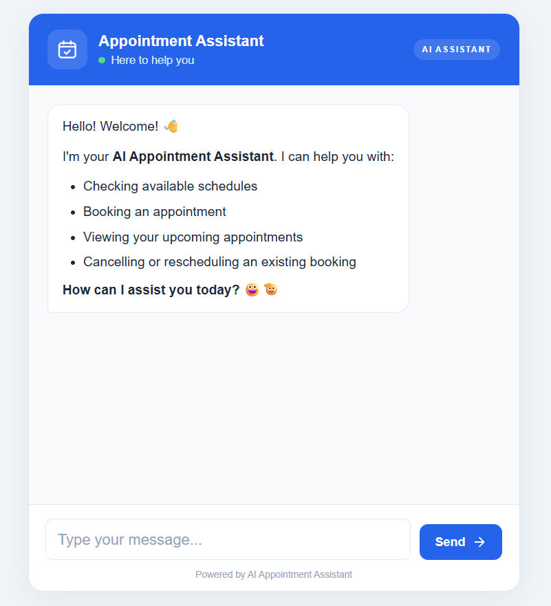

# AI Appointment Assistant

An AI-powered appointment assistant built with **n8n**. Customers can check availability and manage appointments through a web-based chat interface.

## Problem Statement

Managing appointments manually requires businesses to repeatedly check calendars, respond to availability requests, verify customer details, and handle booking changes. These tasks can be time-consuming and increase the chance of scheduling mistakes.

## Solution

This project provides a conversational appointment assistant that automates the appointment process. Customers can check available schedules and, when ready to book, verify their email using a one-time password (OTP). Once authenticated, they can book appointments and manage their existing bookings through the chat interface.

The project is designed as a general-purpose portfolio implementation that can be adapted for different appointment-based businesses.

## Screenshots

### Chat Interface

<p align="center">
  
</p>

<details>
  <summary>View workflow screenshots</summary>

  ### Overall Automation
  

  ### Appointment Tools
  **Book Appointment**
  

  **Find Available Slots Within a Date**
  

  **Find Next Available Slot**
  

  **Find User Appointments**
  

  **Reschedule Appointment**
  

  ### OTP Verification
  **Generate and Send OTP**
  

  **Validate OTP**
  
</details>

## Features

- **Conversational chat interface** – Customers interact with the assistant through a browser-based UI.
- **Appointment availability** – Find available times on a selected date or the next available slot.
- **Email OTP verification** – Verify a customer's email before their first booking.
- **Appointment booking** – Create appointments after the customer selects a schedule and completes verification.
- **Appointment lookup** – Retrieve the authenticated customer's upcoming appointments.
- **Cancellation and rescheduling** – Manage existing appointments with ownership verification.
- **Centralized scheduling configuration** – Configure timezone, working days, business hours, breaks, slot intervals, and appointment durations.
- **Chat history** – Persist conversations and load older messages through pagination.

## Technology Stack

| Technology | Purpose |
|---|---|
| **n8n** | Workflow orchestration, AI agent, webhooks, and serving the chat UI |
| **HTML, CSS, JavaScript** | Browser-based chat interface and interactions with n8n webhooks |
| **Redis** | Temporary conversation data, customer session details, and OTP storage |
| **PostgreSQL** | Persistent chat conversation history |
| **Google Calendar** | Appointment availability and calendar event management |
| **Gmail** | Sending email verification codes |

## How It Works

1. A customer opens the chat interface. A browser cookie is used to track the chat session.
2. The chat UI sends messages to n8n through webhooks and displays the assistant's responses.
3. The AI agent selects the appropriate workflow tool based on the customer's request.
4. Customers can check appointment availability without first completing email verification.
5. When a customer selects a schedule and is ready to book, the assistant requests their email and sends an OTP.
6. After the OTP is validated, the customer's session becomes authenticated.
7. Authenticated customers can book appointments and view, cancel, or reschedule existing bookings.

A **single Google Calendar** is used for both checking availability and managing appointment events.

## AI Agent Tools

| Tool | Purpose | Authentication |
|---|---|---|
| **Find Available Slots Within a Date** | Finds available appointment times on a specified date | Not required |
| **Find Next Available Slot** | Finds the earliest available appointment within the configured search period | Not required |
| **Generate and Send OTP** | Generates a verification code and sends it to the customer's email | Verification flow |
| **Validate OTP** | Validates the code submitted by the customer | Verification flow |
| **Book Appointment** | Creates a new calendar appointment | Required |
| **Find User Appointments** | Retrieves the authenticated customer's upcoming appointments | Required |
| **Cancel User Appointment** | Cancels an existing appointment after ownership verification | Required |
| **Reschedule Appointment** | Books the new schedule and then cancels the original appointment | Required |

## Chat UI

The chat interface is served by n8n and built with HTML, CSS, and JavaScript. The JavaScript communicates with n8n webhook endpoints to send messages and retrieve conversation history.

The UI includes:

- Session tracking through a browser cookie.
- Sending messages and displaying assistant responses.
- Loading older messages through paginated history retrieval.

## Data Storage

- **Redis** stores temporary conversation data, customer session information, and OTP values.
- **PostgreSQL** stores persistent chat conversation history.
- **Google Calendar** stores appointment events and provides the data used for availability checks.

## Scheduling Configuration

Scheduling rules are maintained in a shared n8n Configuration node. Settings include the business timezone, working days, opening and closing hours, lunch breaks, slot intervals, and appointment-type durations.

Availability checks do not reserve a slot. The booking workflow checks availability again before creating the calendar event to reduce scheduling conflicts.

## Repository Structure

```text
.
├── README.md
├── file-list.txt
├── screenshots/
│   ├── Appointment Automation.png
│   ├── ui.png
│   ├── PRJ001 - Tool - Book Appointment.png
│   ├── PRJ001 - Tool - Find Available Slots within the Date.png
│   ├── PRJ001 - Tool - Find Next Available Slot.png
│   ├── PRJ001 - Tool - Find User Appointments.png
│   ├── PRJ001 - Tool - Reschedule Appointment.png
│   ├── Shared - OTP Tool - Validate OTP.png
│   └── Shared OTP Tool - Generate and Send OTP.png
└── workflows/
    ├── Appointment Automation.json
    └── tools/
        ├── PRJ001 - Tool - Book Appointment.json
        ├── PRJ001 - Tool - Find Available Slots within the Date.json
        ├── PRJ001 - Tool - Find Next Available Slot.json
        ├── PRJ001 - Tool - Find User Appointments.json
        ├── PRJ001 - Tool - Reschedule Appointment.json
        ├── Shared - OTP Tool - Validate OTP.json
        └── Shared OTP Tool - Generate and Send OTP.json
```

## Workflow Exports

The exported n8n workflows are available in the [`workflows`](workflows/) directory:

- [Main Appointment Automation](workflows/Appointment%20Automation.json)
- [Book Appointment](workflows/tools/PRJ001%20-%20Tool%20-%20Book%20Appointment.json)
- [Find Available Slots Within a Date](workflows/tools/PRJ001%20-%20Tool%20-%20Find%20Available%20Slots%20within%20the%20Date.json)
- [Find Next Available Slot](workflows/tools/PRJ001%20-%20Tool%20-%20Find%20Next%20Available%20Slot.json)
- [Find User Appointments](workflows/tools/PRJ001%20-%20Tool%20-%20Find%20User%20Appointments.json)
- [Reschedule Appointment](workflows/tools/PRJ001%20-%20Tool%20-%20Reschedule%20Appointment.json)
- [Generate and Send OTP](workflows/tools/Shared%20OTP%20Tool%20-%20Generate%20and%20Send%20OTP.json)
- [Validate OTP](workflows/tools/Shared%20-%20OTP%20Tool%20-%20Validate%20OTP.json)

## Setup Notes

The agent also uses a **Cancel User Appointment** workflow. Its JSON export is not present in the current `workflows/tools/` listing, so export and add that workflow if you want this repository to contain every connected tool workflow.

This repository is a portfolio project. To run it in another environment, you will need an n8n instance and the corresponding Redis, PostgreSQL, Google Calendar, and Gmail connections. Import the workflow JSON files, configure the required credentials and shared scheduling settings, and update any environment-specific webhook or workflow references before activating the workflows.

Do not commit credentials, API keys, session secrets, OTP values, or other private configuration to the repository.
